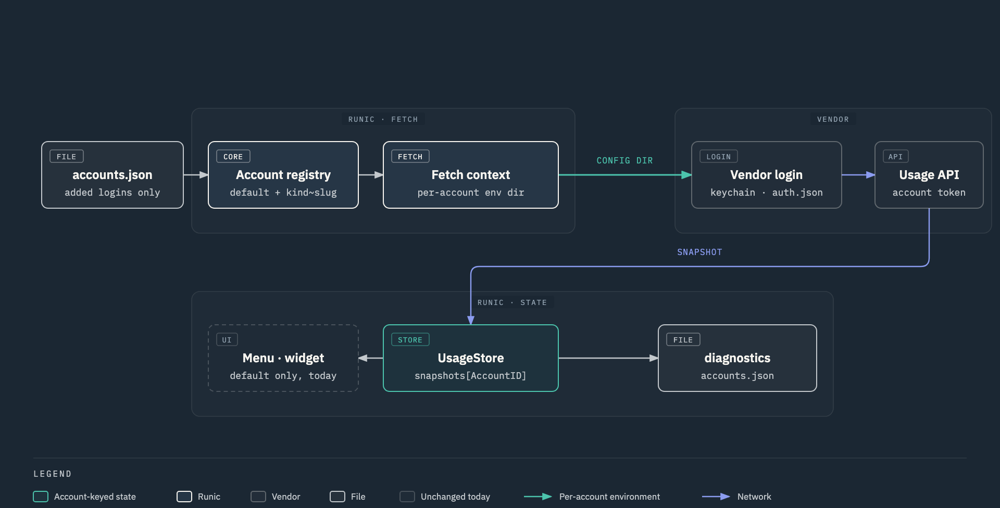

# Accounts, hands on (phase 2, after PRs 1–3)



Interactive version: `accounts-flow.html` (follows light/dark). Design: `accounts-and-windows.md`.

## What exists on main now

- **`AccountID`** is the key for live per-login state in `UsageStore` (snapshots, errors, source labels, fetch attempts, failure gates, credits, the refreshing set). The default account's id is the provider's raw value (`claude`), so nothing on disk changed for one-login installs. An added account is `kind~slug` (`claude~work`).
- **`accounts.json`** in `~/Library/Application Support/Runic/` lists added logins only. A missing file is the one-login world. Each entry has an id, a display name, an optional region, a credential and an enabled flag.
- **A refresh visits every account of a kind.** The default account fetches with the process environment; an added account fetches with its credential's location variable merged in (`CLAUDE_CONFIG_DIR`, `CODEX_HOME`, `KIMI_CODE_HOME`), so the vendor's own credential location is read for that login.
- **Claude** reads the per-directory Keychain item Claude Code writes for a custom config dir: `Claude Code-credentials-<8 hex of sha256(dir)>` (hash over the raw directory string, NFC), or `<dir>/.credentials.json` as the CLI's fallback. **Codex** reads `<CODEX_HOME>/auth.json` and refreshes into the same file.
- **`diagnostics/accounts.json`** is written after every refresh: one row per account the refresh visited, with percentages, resets, source label and error. No tokens, no emails.

## What does not exist yet

- No UI. The menu, widget, CLI and MCP still show the default account only.
- No Add-account sheet: the config dir and `accounts.json` are made by hand (below).
- Nobody refreshes a Claude token in a Runic-owned dir. Claude Code refreshes its token when *it* runs; in a dir where no CLI runs, the access token expires in hours and the account goes dark until you run `claude` there again. The scheduled probe is the next PR.
- Session-quota notifications, burn samples and balance readings are recorded for the default account only.
- The Claude CLI fallback (PTY `/usage`) does not take the config dir yet; an added Claude account must have a usable OAuth token.

## Add a second Claude login by hand

1. Pick a directory for the login. Runic will own these later; any path works now.

   ```sh
   export DIR="$HOME/Library/Application Support/Runic/accounts/claude-work"
   mkdir -p "$DIR"
   ```

2. In the browser, switch to the Claude account you want to add *first*. The CLI login lands on whatever account the browser is signed into.

3. Log in into that directory. First-run prompts (theme, trust) appear because the dir is fresh; answer them.

   ```sh
   CLAUDE_CONFIG_DIR="$DIR" claude /login
   ```

   Check the item landed under the hashed name (attributes only, no secret shown):

   ```sh
   security find-generic-password -s "Claude Code-credentials-$(printf '%s' "$DIR" | shasum -a 256 | cut -c1-8)" | grep svce
   ```

4. Register the account. The slug is yours to pick (short, `[a-z0-9]`); the id is `claude~<slug>`.

   ```json
   {
     "version": 1,
     "accounts": [
       {
         "id": "claude~work",
         "displayName": "work",
         "credential": { "type": "oauthDir", "value": "/Users/you/Library/Application Support/Runic/accounts/claude-work" },
         "isEnabled": true
       }
     ]
   }
   ```

   Save it as `~/Library/Application Support/Runic/accounts.json`. Use the absolute path, the same string you exported: the Keychain name is a hash of that exact string.

5. Relaunch Runic (the registry is read at launch), then Ping now. Read the diagnostics:

   ```sh
   jq '.accounts[] | select(.kind=="claude") | {account, sourceLabel, primaryUsedPercent, secondaryUsedPercent, error}' \
     ~/Library/Application\ Support/Runic/diagnostics/accounts.json
   ```

   Expected: two rows, `claude` and `claude~work`, each with its own percentages and `sourceLabel: "oauth"`. The menu still shows only `claude`.

## Add a second Codex login by hand

Same shape with `CODEX_HOME`:

```sh
export DIR="$HOME/Library/Application Support/Runic/accounts/codex-org"
mkdir -p "$DIR"
CODEX_HOME="$DIR" codex login      # one at a time: two Codex logins collide on the callback port
```

Registry entry: `"id": "codex~org"`, `"credential": { "type": "oauthDir", "value": "<that path>" }`. Runic reads and refreshes `<path>/auth.json`. The `ChatGPT-Account-Id` header comes from that file, which is what makes a second workspace a second account.

## If the added row shows an error

| Error text | Meaning |
|---|---|
| `Claude OAuth credentials not found` | No Keychain item under the hashed name and no `.credentials.json` in the dir. The login went into `~/.claude` instead (env var not exported on the `claude` command), or the path string differs from the registry value. |
| `Claude OAuth token expired` | The token aged out and nothing refreshed it. Run `CLAUDE_CONFIG_DIR="$DIR" claude` once; the next refresh picks it up. |
| `user:profile` scope missing | The login was done with an older CLI or a Console key; redo `/login` with the current CLI. |
| `Codex auth.json exists but contains no tokens` / not found | `codex login` did not write into that `CODEX_HOME`, or the registry path differs. |

## Keychain-key providers (Kimi, z.ai, …)

Not yet by hand. An added account would read `<base>.<slug>` (for example `kimi-api-token.work`) under Runic's credential service, but an item created with the `security` tool carries an ACL that does not trust Runic and prompts on every read. The Add-account sheet (paste a key) writes it correctly; wait for that.

## Switching a terminal to an account

Nothing in the app yet. Today:

```sh
export CLAUDE_CONFIG_DIR="$HOME/Library/Application Support/Runic/accounts/claude-work"
claude
```

The menu's "Switch" action (copies that line) and `runic env claude/work` come with the account tabs.
